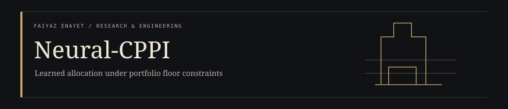
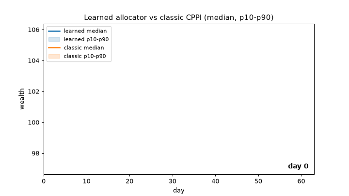

<p align="center"></p>

<p align="center"><a href="https://faiyazenayet.github.io/neural-cppi/docs/dashboard.html"><b>Open interactive demo</b></a> · <a href="docs/dashboard.html">HTML file</a> · <a href="#method">Method</a> · <a href="#run-locally">Run locally</a> · <a href="#limitations">Limitations</a></p>

# Neural-CPPI

A research implementation of neural portfolio insurance. It compares learned allocation policies with classical CPPI and makes the trade between terminal wealth and floor protection inspectable.

**Python · PyTorch · portfolio simulation**

[](https://faiyazenayet.github.io/neural-cppi/docs/dashboard.html)

*The GIF is a recorded tour of the actual dashboard. Click it for the interactive HTML. The prebuilt HTML opens locally without an application server.*

## Explore

- Compare wealth bands with the protection floor across source horizons and classical multipliers.
- Inspect learned allocation at different floor levels, then read the corresponding experimental tables.
- Review transaction-cost assumptions, drawdown constraints and cross-regime evidence alongside returns.

## Method

Historical daily returns generate block-bootstrap scenarios. A neural policy learns risky allocation or a long-only multi-asset mix. Evaluation separates synthetic experiments, resampled market paths and held-out regime tests.

## Evidence at a glance

| Scope | Recorded result or contract |
| :--- | :--- |
| 63-day synthetic learned-policy experiment | Mean terminal wealth 101.70 from initial wealth 100 |
| Same experiment | Terminal wealth standard deviation 3.63; observed terminal-floor breaches 0.3% |
| Interpretation | Finite-sample outcomes, not a capital-protection guarantee |

## Run locally

Start with the prebuilt [HTML file](docs/dashboard.html) for a dependency-free review. To run the source:

```sh
python -m pip install -e ".[dev]"
python -m pip install -r portfolio_ui/requirements.txt
python -m pytest tests -q
python -m dhl.experiments.cppi_learned
python -m dhl.experiments.cppi_multi
python scripts/make_dashboard.py
```

## Code and data

`src/dhl/` contains the policies, market samplers, risk calculations and experiments. `data/` contains the committed daily market observations. `scripts/make_dashboard.py` builds the HTML output.

The dashboard preserves source outputs. Rebuilding research results can require additional data or compute; opening the supplied HTML does not.

## Limitations

- Resampling cannot create a market regime absent from the source history.
- Daily CPPI is exposed to gap risk, discrete rebalancing and transaction costs. Zero observed breaches do not prove zero risk.
- Ablation conclusions need repeated training seeds and uncertainty intervals; a single crisis is a limited stress test.

## License

[MIT](LICENSE). Third-party datasets, libraries and fonts retain their own terms.
