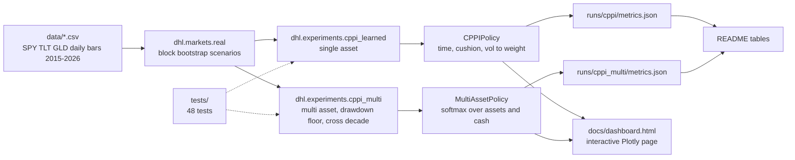

# neural-cppi


**I teach neural networks to protect a portfolio.**

A network learns how to allocate across stocks, bonds, gold, and cash, day by day, guarding a floor under wealth while transaction costs eat every rebalance. The benchmark is the textbook rule, classic CPPI. The question I started with: can the network learn a better trade between growth and safety? The answer, measured on real market data: yes, and the failures are instructive too.


**[Live interactive demo](https://faiyazenayet.github.io/neural-cppi/docs/dashboard.html).** Open the full dashboard as one self contained page. Switch floors, horizons, and multipliers right in the charts. No server needed.

## How the pieces fit



## What it does

You start with 100. You promise yourself you will never finish below 90. Every day you choose where your wealth sits. Classic CPPI answers with a formula: hold the multiplier times your cushion above the floor. It is elegant and it is rigid. It cannot see that volatility just spiked or that the horizon is almost over.

My network sees three things: how much time is left, how far wealth sits above the floor, and recent volatility. It outputs a risky weight. It trains on fresh market scenarios every epoch, maximizing expected terminal wealth minus 30 times the expected shortfall below the floor. The scenarios come from real SPY history, resampled in 21 day blocks so volatility clustering survives. Infinite training data. No memorization possible.

Then I scaled it up. The multi asset policy outputs softmax weights over SPY, TLT, GLD, and cash. Softmax means long only and at most fully invested. No leverage, no shorting, by construction. I added a drawdown floor that ratchets with the running wealth peak, stricter and more realistic than a fixed line. And I ran the stress test I am proudest of: train on pre 2020 data only, then evaluate on paths that include the COVID crash. A regime the network never saw.

## How to run it

```bash
pip install -e .
pytest                                            # 48 tests, all green
python -m dhl.experiments.cppi_learned             # single asset; writes runs/cppi/metrics.json
python -m dhl.experiments.cppi_multi               # multi asset, drawdown floor, cross decade; writes runs/cppi_multi/metrics.json
python scripts/make_dashboard.py                 # rebuilds docs/dashboard.html
python scripts/make_demo_gif.py                   # rebuilds docs/demo.gif
```

Real daily bars for SPY, TLT, and GLD (2015 to 2026) are committed under `data/`. No API key, no download step.

```python
from dhl import CPPIPolicy, train_cppi_policy, block_bootstrap_paths, load_spy_daily, log_returns

data = load_spy_daily()
returns = log_returns(data["adjclose"])
sampler = lambda n, s: block_bootstrap_paths(returns, n, 30, 21, S0=100.0, seed=s)

policy = CPPIPolicy(hidden_dims=(16, 16))
train_cppi_policy(policy, sampler, horizon_days=30, n_epochs=200)
```

## What is in here

* **Price scenario generators:** GBM, Heston stochastic volatility with full truncation Euler or Andersen QE, Merton jump diffusion. SDEs that produce paths, nothing more. Plus the real daily bars and a circular block bootstrap that turns history into test scenarios. The multi asset bootstrap draws the same blocks for every asset, so cross asset correlation survives.
* **Risk measures:** variance, empirical CVaR, entropic risk. Differentiable, usable as training objectives.
* **The single asset experiment:** classic CPPI at multipliers 3, 4, 5 against the learned allocator, on 20,000 held out bootstrapped SPY paths the network never saw. Floor 90, 20 bps costs, daily rebalancing, cash earns 2%.
* **The multi asset experiment:** learned 3 asset allocator vs learned single asset vs classic CPPI on an equal weight mix, plus the drawdown floor and the cross decade stress test. All comparisons here cap the risky allocation at 1.0 (no leverage, long only).
* **The dashboard:** `docs/dashboard.html` is one self contained interactive page built by `scripts/make_dashboard.py`. Policy heatmaps with a floor switcher, learned vs classic wealth bands with horizon and multiplier selectors, the multi asset allocation, and the published results tables. Serve it from any static host.
* **Exact accounting:** self financing wealth, proportional costs on every rebalance, terminal liquidation. Tested.

## Results

### Single asset

30 day horizon, 20,000 held out paths, seed 7:

| Strategy | E[wealth] | Std  | P(breach) |
|----------|-----------|------|-----------|
| CPPI m=3 | 100.52    | 1.61 | 0.000     |
| CPPI m=4 | 100.58    | 2.14 | 0.000     |
| CPPI m=5 | 100.64    | 2.67 | 0.000     |
| Learned  | 100.64    | 2.02 | 0.001     |

63 day horizon:

| Strategy | E[wealth] | Std  | P(breach) |
|----------|-----------|------|-----------|
| CPPI m=3 | 101.22    | 2.46 | 0.000     |
| CPPI m=4 | 101.41    | 3.31 | 0.000     |
| CPPI m=5 | 101.57    | 4.18 | 0.000     |
| Learned  | 102.00    | 4.28 | 0.004     |

The network matches the most aggressive classic multiplier on expected wealth with less wobble at 30 days, and beats it outright at 63 days. The price is a small breach probability where classic CPPI has none on these paths. It learned to trade a little floor risk for extra return. Whether that trade is worth it is your call, not the network's.

Numbers move with seeds. Rerun it and check my work.

### Multi asset

10,000 held out paths, seed 11. One fairness note: these comparisons cap the risky allocation at 1.0, long only, no leverage. The single asset numbers above used a 1.5 cap. The single asset baseline below was retrained under the same no leverage rule, so the comparisons are fair.

30 day horizon:

| Strategy | E[wealth] | Std | P(breach) |
|---|---|---|---|
| Learned multi (3 assets) | 100.78 | 2.85 | 0.001 |
| Learned single (SPY) | 100.61 | 1.96 | 0.001 |
| Classic m=4 (mix) | 100.36 | 1.37 | 0.000 |

63 day horizon:

| Strategy | E[wealth] | Std | P(breach) |
|---|---|---|---|
| Learned multi (3 assets) | 101.97 | 3.85 | 0.001 |
| Learned single (SPY) | 101.59 | 3.01 | 0.003 |
| Classic m=4 (mix) | 100.97 | 2.11 | 0.000 |

Diversification helps the learner: more return at both horizons, at higher volatility. Classic never breaches. Same trade as before, now across assets.

### Drawdown floor

Instead of a fixed 90, the floor ratchets: floor = 0.90 times the running wealth peak. Stricter and more realistic. 63 day horizon, 10,000 paths:

| Strategy | Fixed floor | Drawdown floor |
|---|---|---|
| Learned multi | 101.93 / 3.82 / 0.004 | 101.84 / 3.42 / 0.003 |
| Classic m=4 (mix) | 100.97 / 2.11 / 0.000 | 100.93 / 1.87 / 0.000 |

(Each cell: E[wealth] / Std / P(breach anytime).)

My read: the ratchet works mechanically (the test suite pins the ratcheting down), but it barely binds on 30 to 63 day paths. The drawdown policy is a touch more conservative at 63 days and little else changes. The feature matters more on longer horizons, where peaks have time to build. I report the small effect instead of overselling it.

### Cross decade stress test

I trained the single asset learner on pre 2020 paths only, then evaluated on 2020+ paths that include the COVID crash. A regime the network never saw. 30 day horizon:

| Strategy | E[wealth] | Std | P(breach) |
|---|---|---|---|
| Learned (train pre-2020) | 101.26 | 4.57 | 0.017 |
| Learned (train all years) | 100.74 | 2.20 | 0.002 |
| Classic m=4 | 100.69 | 2.43 | 0.000 |

This is the most interesting table in the repo. The pre 2020 policy earned the most on average and breached more than eight times as often as the all years policy. It never saw a crash, so it learned to be aggressive, and the COVID regime punished exactly that. The all years policy saw crashes in training and behaved. Classic CPPI does not care about regimes: a formula has no memory to overfit. The lesson is not that learning fails. It is that a learned policy is only as worldly as its training data.

## Where I would take it next

* Regime aware features: credit spreads, term structure slope
* More assets and real rebalancing frictions: bid ask spreads, market impact
* Longer horizons where the drawdown floor binds hard

## Honest limitations

* The scenarios are bootstrapped from a kind decade. SPY from 2015 to 2026 is mostly up. A different decade gives different numbers. The cross decade test shows how much the regime matters.
* Three assets is not a universe. SPY, TLT, and GLD diversify each other, but a real allocator faces dozens of assets, currencies, and frictions I do not model.
* The joint bootstrap preserves each block's correlation, but 21 day blocks cannot invent a correlation regime that never happened.
* COVID is one crash. Passing one out of distribution test is evidence, not proof.
* Gap risk is real. An overnight crash bigger than the cushion blows through any daily rule, learned or classic. The test suite pins this down on purpose.
* The fixed floor is 90, not grown at the cash rate. The drawdown floor only bites on longer horizons. A stricter floor changes the trade.
* The network's breach probability is small but not zero. Classic CPPI breaches never on these paths because the formula de risks to exactly zero at the floor. The learned policy accepts the tail to buy return.
* CPU friendly by design. Training takes minutes, not hours.
